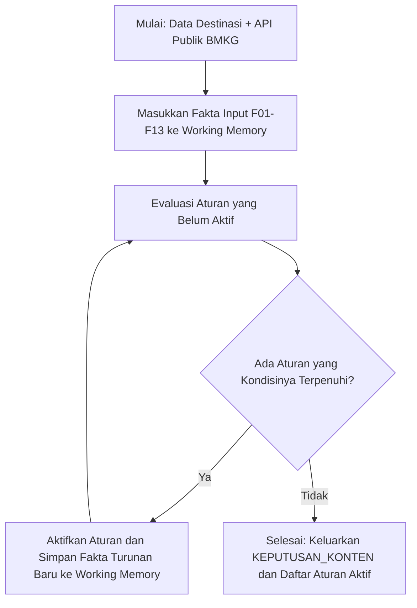
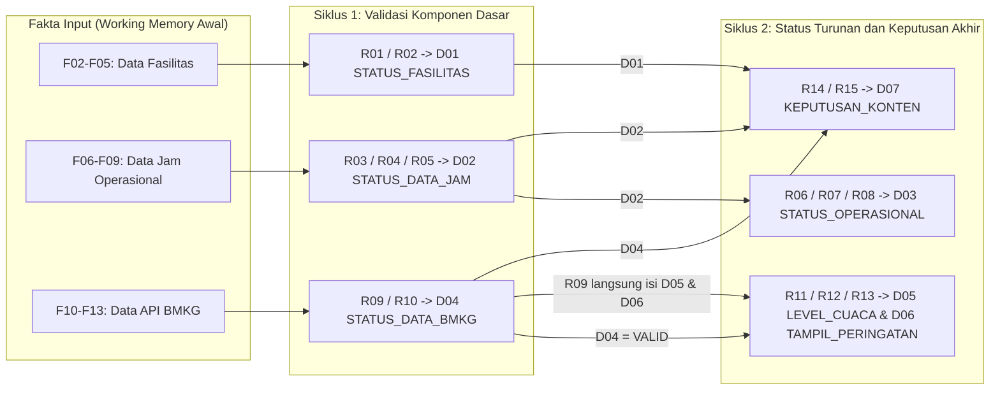

# Rantai Aturan (Forward Chaining) – Knowledge Base Konten Detail Destinasi

Knowledge Base ini menggunakan metode **Forward Chaining** (*data-driven reasoning*), yaitu proses inferensi yang bergerak maju dari fakta input di *Working Memory* (termasuk data cuaca dari API publik BMKG melalui `bmkgAdapter.js`) menuju kesimpulan akhir `KEPUTUSAN_KONTEN`.

## 1. Proses Forward Chaining (Fakta Awal hingga Keputusan Akhir)

1. **Inisialisasi Working Memory:** Seluruh fakta input (`F01`–`F13`) dimasukkan ke dalam *Working Memory*. Fakta cuaca `F10`–`F13` dipasok oleh `bmkgAdapter.js` dari endpoint `https://api.bmkg.go.id/publik/prakiraan-cuaca?adm4={kode_wilayah_tingkat_iv}`.
2. **Siklus 1 (Validasi Data Dasar):** Mesin inferensi mengevaluasi aturan yang hanya bergantung pada fakta input, yaitu:
   - Kelengkapan Fasilitas (`R01` atau `R02`) menghasilkan `D01` (`STATUS_FASILITAS`).
   - Validasi Jam Operasional (`R03`, `R04`, atau `R05`) menghasilkan `D02` (`STATUS_DATA_JAM`).
   - Validasi Data BMKG (`R09` atau `R10`, dengan batas kesegaran `<= 12` jam) menghasilkan `D04` (`STATUS_DATA_BMKG`). Khusus `R09`, aturan ini juga langsung menghasilkan `D05` (`LEVEL_CUACA = TIDAK_DIKETAHUI`) dan `D06` (`TAMPIL_PERINGATAN = INFO_TIDAK_TERSEDIA`).
3. **Siklus 2 (Penentuan Status Lanjutan & Keputusan Akhir):** Mesin mengevaluasi aturan yang bergantung pada fakta turunan dari Siklus 1:
   - Status Operasional (`R06`, `R07`, atau `R08`) menggunakan `D02` (`STATUS_DATA_JAM`) untuk menghasilkan `D03` (`STATUS_OPERASIONAL`).
   - Penentuan Peringatan Cuaca (`R11`, `R12`, atau `R13`) menggunakan `D04 = VALID` untuk menghasilkan `D05` (`LEVEL_CUACA`) dan `D06` (`TAMPIL_PERINGATAN`).
   - Keputusan Konten (`R14` atau `R15`) menggabungkan `D01`, `D02`, dan `D04` untuk menghasilkan `D07` (`KEPUTUSAN_KONTEN`).
4. **Terminasi:** Pada Siklus 3, tidak ada lagi aturan baru yang cocok, sehingga inferensi berhenti dan sistem mengeluarkan keputusan akhir beserta daftar aturan yang aktif.

## 2. Ketergantungan Aturan Penghasil dan Pengguna Fakta Turunan

| Aturan Penghasil | Fakta Turunan yang Dihasilkan | Aturan Pengguna |
|---|---|---|
| `R01` | `STATUS_FASILITAS = LENGKAP` (`D01`) | `R14` |
| `R02` | `STATUS_FASILITAS = TIDAK_LENGKAP` (`D01`) | `R15` |
| `R03`, `R04` | `STATUS_DATA_JAM = KOSONG` / `TIDAK_VALID` (`D02`) | `R08`, `R15` |
| `R05` | `STATUS_DATA_JAM = VALID` (`D02`) | `R06`, `R07`, `R14` |
| `R09` | `STATUS_DATA_BMKG = TIDAK_VALID` (`D04`), sekaligus `D05` & `D06` | `R15` |
| `R10` | `STATUS_DATA_BMKG = VALID` (`D04`) | `R11`, `R12`, `R13`, `R14` |

## 3. Diagram Alur Proses Forward Chaining

## 4. Diagram Hubungan dan Rantai Aturan

