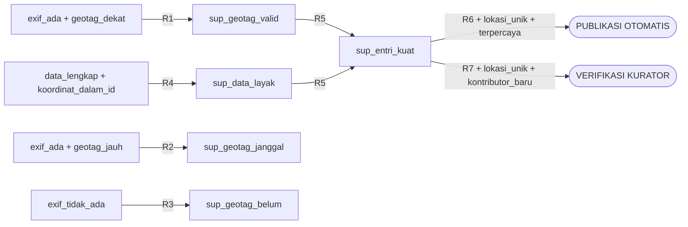

# Bagian Roro — Jalur Geotag & Publikasi (R1–R7)

Kasus keputusan: kurator NusantaraGo menilai entri destinasi crowdsourcing.
Bagian ini menjawab: *apakah entri punya data & geotag yang kuat?* (R1–R5) lalu *siapa yang memutuskan?* (R6–R7).

## Tabel aturan R1–R7

| ID | Kondisi (IF) | Kesimpulan (THEN) | Jenis | Sumber |
|---|---|---|---|---|
| R1 | exif_ada ∧ geotag_dekat | sup_geotag_valid | antara | Blueprint Modul 2 (validasi EXIF); ambang ≤100 m = asumsi tim |
| R2 | exif_ada ∧ geotag_jauh | sup_geotag_janggal | antara | Blueprint Modul 2; ambang >100 m = asumsi tim |
| R3 | exif_tidak_ada | sup_geotag_belum | antara | Blueprint Modul 2 |
| R4 | data_lengkap ∧ koordinat_dalam_id | sup_data_layak | antara | Blueprint Alur 1 langkah 1 |
| R5 | sup_data_layak ∧ sup_geotag_valid | sup_entri_kuat | antara (**jembatan**) | Turunan R1 + R4 |
| R6 | sup_entri_kuat ∧ lokasi_unik ∧ kontributor_terpercaya | **aksi_publikasi** | akhir | Blueprint Modul 2 (reward kontributor) |
| R7 | sup_entri_kuat ∧ lokasi_unik ∧ kontributor_baru | **aksi_kurator** | akhir | Blueprint Alur 1 langkah 3–4 |

## Rantai aturan (jalur utama)

Aturan **jembatan**: R1→R5, R4→R5, R5→R6/R7 (kesimpulan antara jadi syarat aturan berikutnya).
Jalur R2 dan R3 dilanjutkan oleh aturan R8–R9 (bagian Anastasya).

## Skenario 1 — Entri Terpercaya

| | |
|---|---|
| Fakta | data_lengkap, koordinat_dalam_id, exif_ada, geotag_dekat, lokasi_unik, kontributor_terpercaya |
| Siklus 1 | R1 → Geotag valid · R4 → Data layak · R5 → Entri kuat · R6 → PUBLIKASI OTOMATIS |
| **Hasil** | **PUBLIKASI OTOMATIS** |

## Bahan presentasi: fakta vs aturan vs kesimpulan
- **Fakta**: hal yang diamati dari entri, mis. `exif_ada`, `lokasi_unik`.
- **Aturan**: pasangan IF–THEN di JSON, mis. R1.
- **Kesimpulan**: fakta baru hasil aturan. `sup_*` = kesimpulan antara; `aksi_*` = keputusan akhir.
- Satu hal bisa jadi dua peran: `sup_geotag_valid` kesimpulan R1 sekaligus fakta masukan R5.
