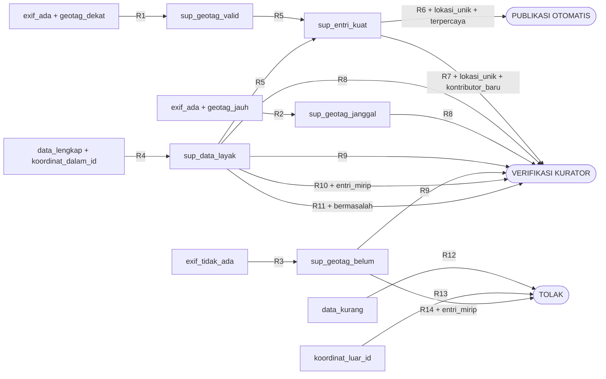

# KB Validasi Entri Destinasi Crowdsourcing (Squad 1 · Issue #6)

**Kasus keputusan:** menentukan nasib entri destinasi baru yang diajukan publik.
**Pengguna keputusan:** Kurator Admin NusantaraGo.
**Keputusan akhir:** `PUBLIKASI OTOMATIS` / `VERIFIKASI KURATOR` / `TOLAK`.
**Metode:** forward chaining, aturan AND-only (format sama dengan simulasi P11).
**Penyusun:** Raden Roro Anindya Anggitoputri (R1–R7, skenario 1) · Anastasya Geovani Manurung (R8–R14, skenario 2–3)

> Ambang batas (100 m geotag, rating 4.0 / 3.0, ≥3 pengajuan disetujui) adalah **asumsi tim**.
> Ambang 500 m bersumber dari blueprint (Alur 1) dan dokumen arsitektur (bagian 3B).

## Tabel aturan

| ID | Kondisi (IF) | Kesimpulan (THEN) | Jenis | Sumber |
|---|---|---|---|---|
| R1 | exif_ada ∧ geotag_dekat | sup_geotag_valid | antara | Blueprint Modul 2; ≤100 m asumsi |
| R2 | exif_ada ∧ geotag_jauh | sup_geotag_janggal | antara | Blueprint Modul 2; >100 m asumsi |
| R3 | exif_tidak_ada | sup_geotag_belum | antara | Blueprint Modul 2 |
| R4 | data_lengkap ∧ koordinat_dalam_id | sup_data_layak | antara | Blueprint Alur 1 |
| R5 | sup_data_layak ∧ sup_geotag_valid | sup_entri_kuat | antara (jembatan) | Turunan R1+R4 |
| R6 | sup_entri_kuat ∧ lokasi_unik ∧ kontributor_terpercaya | **aksi_publikasi** | akhir | Blueprint Modul 2 |
| R7 | sup_entri_kuat ∧ lokasi_unik ∧ kontributor_baru | **aksi_kurator** | akhir | Blueprint Alur 1 |
| R8 | sup_data_layak ∧ sup_geotag_janggal | **aksi_kurator** | akhir | Turunan R2 |
| R9 | sup_data_layak ∧ sup_geotag_belum | **aksi_kurator** | akhir | Turunan R3 |
| R10 | sup_data_layak ∧ entri_mirip | **aksi_kurator** | akhir | Arsitektur 3B (≤500 m) |
| R11 | sup_data_layak ∧ kontributor_bermasalah | **aksi_kurator** | akhir | Asumsi tim |
| R12 | data_kurang | **aksi_tolak** | akhir | Blueprint Alur 1 |
| R13 | koordinat_luar_id | **aksi_tolak** | akhir | SRID 4326 / wilayah ID |
| R14 | entri_mirip ∧ sup_geotag_belum | **aksi_tolak** | akhir | Asumsi tim |

## Rantai aturan (jembatan: R1→R5, R4→R5, R5→R6/R7)

## Prioritas konflik
**TOLAK > VERIFIKASI KURATOR > PUBLIKASI OTOMATIS.** Diimplementasikan lewat urutan kunci `conclusions` di `kb-squad1.json`; mesin mengambil tujuan terakhir yang menyala.

## 3 skenario uji (`node test-inferensi.js`)

| Skenario | Fakta | Aturan menyala | Hasil |
|---|---|---|---|
| 1. Entri Terpercaya | data_lengkap, koordinat_dalam_id, exif_ada, geotag_dekat, lokasi_unik, kontributor_terpercaya | R1, R4, R5, R6 | PUBLIKASI OTOMATIS |
| 2. Perlu Dicek Kurator | data_lengkap, koordinat_dalam_id, exif_ada, geotag_jauh, entri_mirip, kontributor_baru | R2, R4, R8 | VERIFIKASI KURATOR |
| 3. Ditolak (konflik) | data_lengkap, koordinat_dalam_id, exif_tidak_ada, entri_mirip, kontributor_baru | R3, R4, R9, R14 | TOLAK |

Detail konsep dan bahan presentasi: `README-roro.md` dan `README-anastasya.md`.
