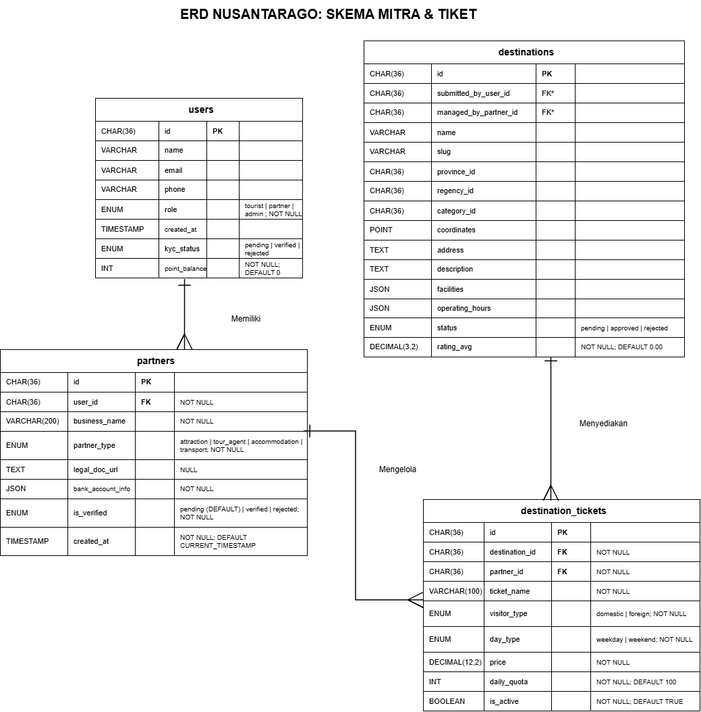

# Database ERD – Squad 2 Sprint 1

## Overview

This folder contains the revised Entity Relationship Diagram (ERD) for the NusantaraGo project, Squad 2 – Sprint 1.

The ERD describes the database structure for user accounts, partner registration, destination management, and destination tickets.

The diagram follows the revised database design using MySQL-compatible data types.

## Database Entities

The ERD consists of four main tables:

### 1. users

Stores user account information.

Main attributes:
- `id` – CHAR(36), Primary Key
- `name` – VARCHAR
- `email` – VARCHAR
- `phone` – VARCHAR
- `role` – ENUM('tourist', 'partner', 'admin')
- `created_at` – TIMESTAMP
- `kyc_status` – ENUM('pending', 'verified', 'rejected')
- `point_balance` – INT, DEFAULT 0

### 2. partners

Stores partner business and verification information.

Main attributes:
- `id` – CHAR(36), Primary Key
- `user_id` – CHAR(36), Foreign Key
- `business_name` – VARCHAR(200)
- `partner_type` – ENUM('attraction', 'tour_agent', 'accommodation', 'transport')
- `legal_doc_url` – TEXT
- `bank_account_info` – JSON
- `is_verified` – ENUM('pending', 'verified', 'rejected'), DEFAULT 'pending'
- `created_at` – TIMESTAMP, DEFAULT CURRENT_TIMESTAMP

### 3. destinations

Stores destination information and management details.

Main attributes:
- `id` – CHAR(36), Primary Key
- `submitted_by_user_id` – CHAR(36), FK*
- `managed_by_partner_id` – CHAR(36), FK*
- `name` – VARCHAR
- `slug` – VARCHAR
- `province_id` – CHAR(36)
- `regency_id` – CHAR(36)
- `category_id` – CHAR(36)
- `coordinates` – POINT
- `address` – TEXT
- `description` – TEXT
- `facilities` – JSON
- `operating_hours` – JSON
- `status` – ENUM('pending', 'approved', 'rejected')
- `rating_avg` – DECIMAL(3,2), DEFAULT 0.00

### 4. destination_tickets

Stores ticket information associated with destinations and partners.

Main attributes:
- `id` – CHAR(36), Primary Key
- `destination_id` – CHAR(36), Foreign Key
- `partner_id` – CHAR(36), Foreign Key
- `ticket_name` – VARCHAR(100)
- `visitor_type` – ENUM('domestic', 'foreign')
- `day_type` – ENUM('weekday', 'weekend')
- `price` – DECIMAL(12,2)
- `daily_quota` – INT, DEFAULT 100
- `is_active` – BOOLEAN, DEFAULT TRUE

## Entity Relationships

The ERD illustrates the following relationships:

1. **users → partners (1:N)**  
   One user can be associated with multiple partner records through `partners.user_id`.

2. **partners → destination_tickets (1:N)**  
   One partner can manage multiple destination tickets through `destination_tickets.partner_id`.

3. **destinations → destination_tickets (1:N)**  
   One destination can provide multiple ticket types through `destination_tickets.destination_id`.

The `destinations` table also includes `submitted_by_user_id` and `managed_by_partner_id`, marked as `FK*` in the diagram. Their foreign key constraints should be checked against the complete database schema.

## MySQL Data Type Adjustments

The revised ERD uses the following MySQL-compatible data types:

- `CHAR(36)` for identifiers.
- `ENUM` for predefined status and category values.
- `JSON` for structured data such as bank account information, facilities, and operating hours.
- `POINT` for destination coordinates.
- `INT` for point balance and daily ticket quota.
- `DECIMAL(3,2)` for average ratings.
- `DECIMAL(12,2)` for ticket prices.
- `BOOLEAN` for ticket activation status.

## ERD Preview

## Editable ERD – Draw.io

The editable ERD source file is stored in Google Drive.

**[Open Latest NusantaraGo ERD (Draw.io)](https://drive.google.com/file/d/1tpfdUFv1pY9cwiTTgfelZ2KsXkej60d-/view?usp=sharing)**

## File Information

- **Project:** NusantaraGo
- **Squad:** 2
- **Sprint:** 1
- **Database:** MySQL
- **Diagram Tool:** Draw.io
- **Source File:** `ERD_NusantaraGo.drawio`
- **ERD Image:** `erd-nusantarago-mitra-tiket.png`
- **Status:** Revised ERD
