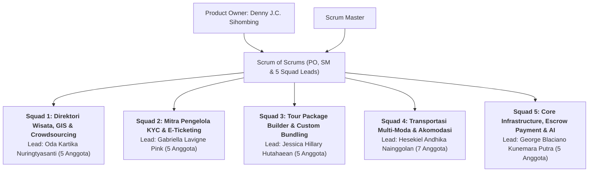

# 👥 Struktur Organisasi & Pembagian Resmi 5 Squad
**Proyek:** Ekosistem Super-App Pariwisata Nasional Indonesia (NusantaraGo)  
**Product Owner:** **Denny J.C. Sihombing**  
**Scrum Master:** Denny J.C. Sihombing  
**Acuan Pembagian:** Berkas `team.xlsx` (*Sheet: Sistem Pendukung Keputusan*)  
**Target Rilis Penuh:** **22 Desember 2026** (6 Minggu Akselerasi)

---

## 🏛️ Bagan Tata Kelola Scrum of Scrums

---

## 📋 Rincian 5 Squad & Penugasan 27 Mahasiswa

### 🗺️ Squad 1: Direktori Wisata 38 Provinsi, Geospasial PostGIS & Crowdsourcing
* **GitHub Label:** `squad-1`
* **Area Fokus:** Modul 1 (Direktori Destinasi 38 Provinsi, Pencarian Radius PostGIS) & Modul 2 (Pendaftaran Publik, Geotagging Foto EXIF).
* **Komponen Kode:** `apps/web-portal`, `services/api-core/modules/destinations`, `services/api-core/modules/spatial`.

| No | NIM / Campus ID | Nama Mahasiswa | Peran Tim | Tanggung Jawab Spesifik |
| :---: | :---: | :--- | :---: | :--- |
| 1 | 202404560028 | **ODA KARTIKA NURINGTYASANTI** | **Squad Lead** | Arsitektur Geospasial PostGIS & Koordinasi Tim |
| 2 | 202404560033 | LINDA WATI PURBA | QA Tester | Verifikasi Kualitas Data & Seeding Wisata 38 Provinsi |
| 3 | 202404560036 | RADEN RORO ANINDYA ANGGITOPUTRI | Frontend Web | Portal Direktori Publik (Next.js) & Filter Multi-Dimensi |
| 4 | 202404560037 | ANASTASYA GEOVANI MANURUNG | Mobile Frontend | Peta Interaktif (Flutter), Klaster Pin & Upload Geotag EXIF |
| 5 | 202404560019 | CORNELIUS DICHO DHARMAWAN | Backend Engineer | Endpoint Spasial `ST_DWithin` & Pencarian Cepat Elasticsearch |

---

### 🎟️ Squad 2: Mitra Pengelola (KYC), Legalitas Pengelola & E-Ticketing System
* **GitHub Label:** `squad-2`
* **Area Fokus:** Modul 2 (Klaim Mitra Resmi, Verifikasi Dokumen KYC/KYB & Kurasi) & Modul 5.1/6 (E-Ticketing, Generator QR Code & Scanner App).
* **Komponen Kode:** `apps/admin-partner`, `apps/mobile/lib/scanner`, `services/api-core/modules/partners`, `services/api-core/modules/tickets`.

| No | NIM / Campus ID | Nama Mahasiswa | Peran Tim | Tanggung Jawab Spesifik |
| :---: | :---: | :--- | :---: | :--- |
| 1 | 202404560020 | **GABRIELLA LAVIGNE PINK** | **Squad Lead** | Desain Alur KYC/KYB & Koordinasi Produk Mitra |
| 2 | 202404560005 | EDWARD ANTONIO HERLAMBANG HUTAURUK | Fullstack Developer | Formulir Onboarding Mitra & Upload Berkas KTP/NIB/SK |
| 3 | 202404560021 | BRIGID PAULINE RATU PATTY DIAZ | UI/UX & Frontend | Dashboard Kurator Admin & Moderasi Duplikasi Haversine |
| 4 | 202404560023 | JO SUK SIN | Backend Engineer | Mesin E-Ticketing, Manajemen Kuota Harian & Diferensiasi Tarif |
| 5 | 202404560040 | ALOYSIA CARLA PUTRI HARYADI | Mobile Engineer | Aplikasi Mobile Pemindai (*Ticket Scanner*) Petugas Gerbang |

---

### 🎒 Squad 3: Tour Package Builder Engine & Custom Trip Bundling
* **GitHub Label:** `squad-3`
* **Area Fokus:** Modul 3 (Manajemen Paket Wisata, Open/Private Trip, Dynamic Pricing Pax Tiering, & Keranjang Custom Bundling Wisatawan).
* **Komponen Kode:** `apps/mobile/lib/packages`, `apps/admin-partner/packages`, `services/api-core/modules/packages`.

| No | NIM / Campus ID | Nama Mahasiswa | Peran Tim | Tanggung Jawab Spesifik |
| :---: | :---: | :--- | :---: | :--- |
| 1 | 202404560050 | **JESSICA HILLARY HUTAHAEAN** | **Squad Lead** | Arsitektur Tour Package Engine & Koordinasi Fitur |
| 2 | 202404560035 | JOEL OKTAVIANUS | Backend Engineer | Logika Package Builder, JSONB Itinerary & Dynamic Pricing Pax |
| 3 | 202404560045 | BINTANG NEERA | Fullstack Developer | Wizard Pembuatan Paket Tur di Portal Mitra & Katalog Mobile |
| 4 | 202404560025 | VICENTIUS ELANG KRISNANTO | Mobile Developer | Antarmuka Custom Trip Builder (Multi-Item Cart di Flutter) |
| 5 | 202404560008 | ALBERTUS CHANDRA HALIM | QA Tester | Skenario Pengujian Paket Tur & Validasi Rombongan Wisata |

---

### 🚗 Squad 4: Transportasi Multi-Moda & Extranet Akomodasi Lokal (Homestay/Glamping)
* **GitHub Label:** `squad-4`
* **Area Fokus:** Modul 4 (Transportasi Antarkota API, Last-Mile Rental Mobil/Kapal/Jip, Rute Multi-Moda) & Modul 5 (Extranet Homestay Desa Wisata, Kalender Kamar, Radius Mapping).
* **Komponen Kode:** `apps/admin-partner/extranet`, `apps/mobile/lib/logistics`, `services/api-core/modules/logistics`.

| No | NIM / Campus ID | Nama Mahasiswa | Peran Tim | Tanggung Jawab Spesifik |
| :---: | :---: | :--- | :---: | :--- |
| 1 | 202404560052 | **HESEKIEL ANDHIKA NAINGGOLAN** | **Squad Lead** | Integrasi Sistem Logistik & Koordinasi Squad 4 |
| 2 | 202404560027 | JOSUE FREITAS DA COSTA | Fullstack Developer | Extranet Manajemen Kamar Homestay & Kalender Ketersediaan |
| 3 | 202204560029 | SYRILLYA CHANTIKA VALENTINA SITOHANG | Senior Fullstack | Kalkulator Estimasi Rute Multi-Moda & Integrasi API Agregator |
| 4 | 202404560029 | FRANS NICHOLAS RAFAEL | Mobile Frontend | UI Pemesanan Kamar Homestay & Rental Armada Lokal di Flutter |
| 5 | 202404560017 | THEODOMIRO FIDELIO TOMASOA | Backend Engineer | Marketplace Transportasi Lokal (Lepas Kunci vs Dengan Driver) |
| 6 | 202204560032 | CAESAR GATTACA | Senior Backend | Relasi Database Spasial, Distance Matrix API & Radius Mapping |
| 7 | 202404560051 | YOSEP HERMAWAN | QA Tester | Pengujian End-to-End Reservasi Penginapan & Armada Transportasi |

---

### 🛡️ Squad 5: Core Infrastructure, Escrow Payment & AI Smart Services
* **GitHub Label:** `squad-5`
* **Area Fokus:** Modul 6 (AI Smart Itinerary Gemini API, Tombol SOS BMKG/SAR), Payment Gateway (Midtrans/Xendit), Escrow Ledger, Concurrency (Redis Redlock), & CI/CD DevOps.
* **Komponen Kode:** `services/api-core/modules/payments`, `services/api-core/modules/ai`, `.github/workflows`, `kpi-app`.

| No | NIM / Campus ID | Nama Mahasiswa | Peran Tim | Tanggung Jawab Spesifik |
| :---: | :---: | :--- | :---: | :--- |
| 1 | 202404560049 | **GEORGE BLACIANO KUNEMARA PUTRA** | **Squad Lead** | Koordinasi Core Engine, DevOps & Monitoring Sistem |
| 2 | 202404560054 | RAFAEL ELANO PRASETYA | Core Backend & Security | Arsitektur Escrow Ledger & Inventory Locking (Redis Redlock) |
| 3 | 202404560009 | EZEKIEL MATHEO BARUS | Backend Engineer | Integrasi Payment Gateway (Midtrans/Xendit) & Webhook SHA512 |
| 4 | 202404560001 | MICHAEL DEVON EKA PUTRA | AI Engineer | Generator AI Smart Itinerary (Gemini API Prompt Engineering) |
| 5 | 202404560039 | IMANUEL JULIVAL LUMBAN GAOL | DevOps & Mobile SOS | Pipeline CI/CD GitHub Actions & Tombol Darurat SOS BMKG/SAR |

---

## 📌 Alur Komunikasi & Ritme Scrum of Scrums

* **Scrum of Scrums (3x Seminggu):** Senin, Rabu, Jumat pukul 13.30–13.50 WIB via Discord/Google Meet.
  * *Peserta Wajib:* SM + 5 Squad Leads (**Oda, Gabriella, Jessica, Hesekiel, George**) + PO (**Denny J.C. Sihombing**).
* **Evaluasi Mingguan / Sprint Demo:** Setiap akhir pekan bersama Product Owner sebelum penutupan Sprint.
