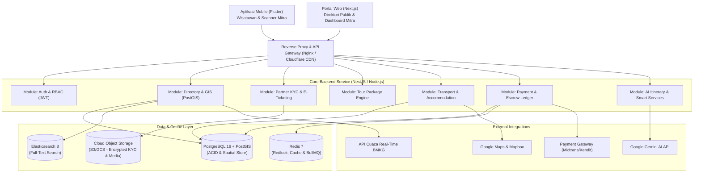

# Dokumen Arsitektur & Spesifikasi Teknis Sistem NusantaraGo
**Sistem:** Ekosistem Super-App Pariwisata Nasional Indonesia (NusantaraGo)  
**Tenggat Waktu Implementasi:** 22 Desember 2026  
**Product Owner:** Denny J.C. Sihombing  
**Tim Pengembang:** 27 Mahasiswa Sistem Informasi (5 Squads)

---

## 1. Arsitektur Sistem Global

Sistem mengadopsi pendekatan **Modular Monolith** dengan batas domain (*domain boundaries*) yang jelas, dirancang agar mudah diekstrak menjadi arsitektur *microservices* saat skala transaksi meningkat.



---

## 2. Spesifikasi Skema Basis Data Inti (PostgreSQL + PostGIS DDL)

Ekstensi PostGIS diaktifkan untuk menangani koordinat geospasial bola bumi standar WGS84 (`SRID 4326`).

```sql
-- 1. Inisialisasi Ekstensi Spasial
CREATE EXTENSION IF NOT EXISTS postgis;
CREATE EXTENSION IF NOT EXISTS "uuid-ossp";

-- 2. Tabel Pengguna (Users & RBAC)
CREATE TYPE user_role AS ENUM ('tourist', 'partner', 'admin', 'guide');
CREATE TYPE kyc_status_enum AS ENUM ('unverified', 'pending', 'verified', 'rejected');

CREATE TABLE users (
    id UUID PRIMARY KEY DEFAULT uuid_generate_v4(),
    role user_role NOT NULL DEFAULT 'tourist',
    name VARCHAR(150) NOT NULL,
    email VARCHAR(150) UNIQUE NOT NULL,
    password_hash VARCHAR(255) NOT NULL,
    phone VARCHAR(30),
    kyc_status kyc_status_enum DEFAULT 'unverified',
    point_balance INT DEFAULT 0,
    created_at TIMESTAMP WITH TIME ZONE DEFAULT CURRENT_TIMESTAMP,
    updated_at TIMESTAMP WITH TIME ZONE DEFAULT CURRENT_TIMESTAMP
);

-- 3. Tabel Profil Mitra (Partners)
CREATE TYPE partner_type_enum AS ENUM ('attraction', 'tour_agent', 'accommodation', 'transport');

CREATE TABLE partners (
    id UUID PRIMARY KEY DEFAULT uuid_generate_v4(),
    user_id UUID NOT NULL REFERENCES users(id) ON DELETE CASCADE,
    business_name VARCHAR(200) NOT NULL,
    partner_type partner_type_enum NOT NULL,
    legal_doc_url TEXT,
    bank_account_info JSONB NOT NULL, -- {bank_name, account_number, account_holder}
    is_verified BOOLEAN DEFAULT FALSE,
    created_at TIMESTAMP WITH TIME ZONE DEFAULT CURRENT_TIMESTAMP
);

-- 4. Tabel Destinasi Wisata (Destinations) dengan Geometri PostGIS
CREATE TYPE destination_status AS ENUM ('draft', 'pending', 'approved', 'rejected');

CREATE TABLE destinations (
    id UUID PRIMARY KEY DEFAULT uuid_generate_v4(),
    submitted_by_user_id UUID REFERENCES users(id),
    managed_by_partner_id UUID REFERENCES partners(id),
    name VARCHAR(200) NOT NULL,
    slug VARCHAR(250) UNIQUE NOT NULL,
    province_id INT NOT NULL,
    regency_id INT NOT NULL,
    category VARCHAR(50) NOT NULL, -- Alam, Budaya, Sejarah, Kuliner, Desa Wisata
    coordinates GEOMETRY(Point, 4326) NOT NULL,
    address TEXT NOT NULL,
    description TEXT NOT NULL,
    facilities JSONB DEFAULT '{"toilet": true, "mushola": true, "parking": true, "cellular_signal": "strong"}'::jsonb,
    operating_hours JSONB DEFAULT '{"open": "08:00", "close": "17:00", "timezone": "WIB"}'::jsonb,
    status destination_status DEFAULT 'pending',
    rating_avg NUMERIC(3,2) DEFAULT 0.0,
    review_count INT DEFAULT 0,
    created_at TIMESTAMP WITH TIME ZONE DEFAULT CURRENT_TIMESTAMP
);

-- Indeks Spasial GIST untuk pencarian super cepat
CREATE INDEX idx_destinations_coordinates ON destinations USING GIST (coordinates);

-- 5. Tabel Tiket Masuk Objek Wisata (Destination Tickets)
CREATE TABLE destination_tickets (
    id UUID PRIMARY KEY DEFAULT uuid_generate_v4(),
    destination_id UUID NOT NULL REFERENCES destinations(id) ON DELETE CASCADE,
    ticket_name VARCHAR(100) NOT NULL,
    visitor_type VARCHAR(20) NOT NULL, -- domestic / foreign
    day_type VARCHAR(20) NOT NULL,     -- weekday / weekend
    price NUMERIC(12,2) NOT NULL,
    daily_quota INT NOT NULL DEFAULT 100,
    is_active BOOLEAN DEFAULT TRUE
);

-- 6. Tabel Inventaris Akomodasi & Kamar
CREATE TABLE accommodations (
    id UUID PRIMARY KEY DEFAULT uuid_generate_v4(),
    partner_id UUID NOT NULL REFERENCES partners(id) ON DELETE CASCADE,
    name VARCHAR(200) NOT NULL,
    property_type VARCHAR(50) NOT NULL, -- homestay, glamping, villa, hotel
    coordinates GEOMETRY(Point, 4326) NOT NULL,
    address TEXT NOT NULL
);
CREATE INDEX idx_accommodations_coordinates ON accommodations USING GIST (coordinates);

CREATE TABLE accommodation_rooms (
    id UUID PRIMARY KEY DEFAULT uuid_generate_v4(),
    accommodation_id UUID NOT NULL REFERENCES accommodations(id) ON DELETE CASCADE,
    room_name VARCHAR(100) NOT NULL,
    capacity_pax INT NOT NULL DEFAULT 2,
    base_price_per_night NUMERIC(12,2) NOT NULL,
    total_stock INT NOT NULL DEFAULT 1
);

-- 7. Tabel Layanan Transportasi Lokal
CREATE TABLE transport_services (
    id UUID PRIMARY KEY DEFAULT uuid_generate_v4(),
    partner_id UUID NOT NULL REFERENCES partners(id) ON DELETE CASCADE,
    vehicle_type VARCHAR(50) NOT NULL, -- car, boat, jeep, motorbike
    model_name VARCHAR(100) NOT NULL,
    capacity_passengers INT NOT NULL,
    rental_scheme VARCHAR(50) NOT NULL, -- with_driver, self_drive, per_route
    price_per_day NUMERIC(12,2) NOT NULL
);

-- 8. Tabel Paket Wisata (Tour Packages)
CREATE TABLE tour_packages (
    id UUID PRIMARY KEY DEFAULT uuid_generate_v4(),
    partner_id UUID NOT NULL REFERENCES partners(id) ON DELETE CASCADE,
    title VARCHAR(250) NOT NULL,
    package_type VARCHAR(30) NOT NULL, -- open_trip / private_trip
    duration_days INT NOT NULL DEFAULT 1,
    min_pax INT NOT NULL DEFAULT 1,
    max_pax INT NOT NULL DEFAULT 20,
    base_price NUMERIC(12,2) NOT NULL,
    itinerary_details JSONB NOT NULL, -- [{day: 1, time: "09:00", activity: "Trekking", destination_id: "..."}]
    cancellation_policy TEXT,
    created_at TIMESTAMP WITH TIME ZONE DEFAULT CURRENT_TIMESTAMP
);

-- 9. Tabel Transaksi Pemesanan (Bookings & Items)
CREATE TYPE booking_status_enum AS ENUM ('unpaid', 'paid', 'confirmed', 'completed', 'cancelled', 'refunded');

CREATE TABLE bookings (
    id UUID PRIMARY KEY DEFAULT uuid_generate_v4(),
    booking_code VARCHAR(30) UNIQUE NOT NULL,
    user_id UUID NOT NULL REFERENCES users(id),
    total_amount NUMERIC(14,2) NOT NULL,
    status booking_status_enum DEFAULT 'unpaid',
    payment_method VARCHAR(50),
    payment_gateway_ref VARCHAR(100),
    qr_code_hash VARCHAR(255) UNIQUE,
    expires_at TIMESTAMP WITH TIME ZONE NOT NULL,
    created_at TIMESTAMP WITH TIME ZONE DEFAULT CURRENT_TIMESTAMP
);

CREATE TABLE booking_items (
    id UUID PRIMARY KEY DEFAULT uuid_generate_v4(),
    booking_id UUID NOT NULL REFERENCES bookings(id) ON DELETE CASCADE,
    item_type VARCHAR(50) NOT NULL, -- ticket, package, accommodation, transport
    item_reference_id UUID NOT NULL,
    visit_date DATE NOT NULL,
    quantity INT NOT NULL,
    price_per_unit NUMERIC(12,2) NOT NULL,
    subtotal NUMERIC(14,2) NOT NULL
);

-- 10. Buku Besar Penampungan Dana (Escrow Ledgers)
CREATE TYPE escrow_status_enum AS ENUM ('held', 'disbursed', 'refunded');

CREATE TABLE escrow_ledgers (
    id UUID PRIMARY KEY DEFAULT uuid_generate_v4(),
    booking_id UUID NOT NULL REFERENCES bookings(id),
    partner_id UUID NOT NULL REFERENCES partners(id),
    gross_amount NUMERIC(14,2) NOT NULL,
    platform_fee NUMERIC(14,2) NOT NULL,
    net_payout NUMERIC(14,2) NOT NULL,
    status escrow_status_enum DEFAULT 'held',
    disbursed_at TIMESTAMP WITH TIME ZONE,
    created_at TIMESTAMP WITH TIME ZONE DEFAULT CURRENT_TIMESTAMP
);
```

---

## 3. Algoritma Spasial & Logika Bisnis Kritis

### A. Pencarian Radius Geospasial (PostGIS)
Query untuk menemukan objek wisata dalam radius $R$ meter dari koordinat pengguna:
```sql
SELECT 
    id, name, slug, category, rating_avg,
    ST_Distance(coordinates, ST_SetSRID(ST_MakePoint($user_lon, $user_lat), 4326)::geography) AS distance_meters
FROM destinations
WHERE status = 'approved'
  AND ST_DWithin(coordinates, ST_SetSRID(ST_MakePoint($user_lon, $user_lat), 4326)::geography, $radius_meters)
ORDER BY distance_meters ASC
LIMIT 50;
```

### B. Algoritma Deteksi Duplikasi Lokasi (Haversine Formula)
Saat pengguna mengajukan objek wisata baru, sistem menghitung jarak ke objek terdaftar terdekat. Jika $\text{jarak} \le 500\text{ meter}$, status pengajuan ditandai `POTENTIAL_DUPLICATE`:
$$\text{haversine}(d) = 2r \arcsin\left(\sqrt{\sin^2\left(\frac{\Delta \phi}{2}\right) + \cos(\phi_1)\cos(\phi_2)\sin^2\left(\frac{\Delta \lambda}{2}\right)}\right)$$

---

## 4. Mekanisme Pencegahan Overbooking (Redis Redlock & DB Serializable)

Untuk mencegah dua pengguna memesan kuota tiket atau kamar terakhir secara bersamaan (*race condition*), sistem menerapkan **Two-Tier Concurrency Control**:

1. **Tier 1: Redis Distributed Lock (TTL 15 Menit):**
   * Key: `lock:inventory:{item_type}:{item_id}:{date}`
   * Jika lock berhasil diperoleh, stok di-reserve sementara selama alur pengisian data dan pembayaran.
2. **Tier 2: Transaksi Database Tingkat `SERIALIZABLE`:**
   ```sql
   BEGIN TRANSACTION ISOLATION LEVEL SERIALIZABLE;
   -- Validasi sisa kuota harian
   SELECT daily_quota - COALESCE(SUM(quantity), 0) INTO remaining_quota
   FROM booking_items bi
   JOIN bookings b ON bi.booking_id = b.id
   WHERE bi.item_reference_id = $ticket_id 
     AND bi.visit_date = $visit_date 
     AND b.status IN ('paid', 'confirmed');
   
   IF remaining_quota >= $requested_qty THEN
       -- Eksekusi reservasi
       INSERT INTO bookings (...) VALUES (...);
       COMMIT;
   ELSE
       ROLLBACK;
       -- Kembalikan respons Out of Stock
   END IF;
   ```

---

## 5. Alur Keuangan & Rekonsiliasi Escrow

1. **Payment Notification:** Webhook dari Midtrans/Xendit diterima di `/api/v1/payments/webhook`.
2. **Signature Verification:** Memverifikasi hash `SHA512(order_id + status_code + gross_amount + ServerKey)` untuk memastikan integritas pesan.
3. **Pencatatan Escrow:** Dana masuk ke `escrow_ledgers` dengan status `held`.
4. **Verifikasi Check-in di Lokasi:** Petugas pintu masuk memindai QR Code pengunjung menggunakan aplikasi mobile scanner.
5. **Auto-Disbursement:** Status booking berubah menjadi `completed`, mentrigger mutasi pencairan dana dari `held` menjadi `disbursed` ke rekening mitra setelah dipotong komisi platform (5%).

---

## 6. Integrasi AI Smart Itinerary Planner (Gemini API)

Layanan AI dirancang menggunakan **Google Gemini API** dengan keluaran terstruktur (*Structured JSON Output*):

```typescript
const prompt = `Sebagai pakar perjalanan Indonesia, susun rencana liburan untuk:
Durasi: ${durationDays} hari
Lokasi Utama: ${destinationRegion}
Anggaran: Rp ${budgetTotal}
Preferensi: ${categories.join(', ')}

Hasilkan respon JSON dengan skema berikut:
{
  "trip_title": string,
  "daily_plans": [
    {
      "day": number,
      "schedule": [
        {"time": string, "activity": string, "estimated_cost": number, "destination_name": string}
      ]
    }
  ],
  "estimated_total_cost": number
}`;
```

---

## 7. Strategi Pengujian & Skalabilitas (K6 Load Test Script)

Pengujian beban dilakukan sebelum rilis 22 Desember 2026 menggunakan skenario K6 untuk menyimulasikan 2.000 virtual users (VUs):
* **Target Latency:** $p(95) < 800\text{ ms}$ pada endpoint pencarian geospasial.
* **Target Throughput:** 500 transaksi pemesanan serentak per detik tanpa *overselling*.
